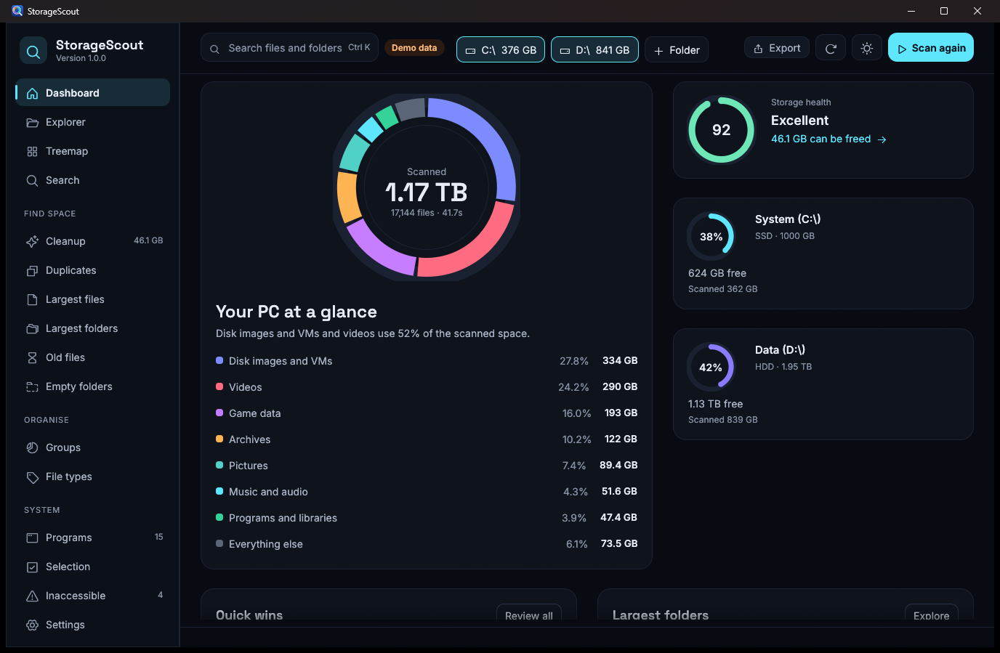
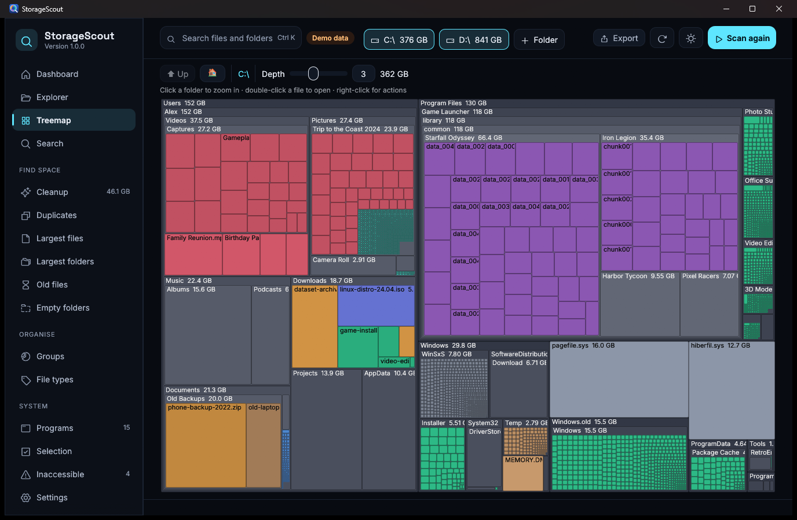
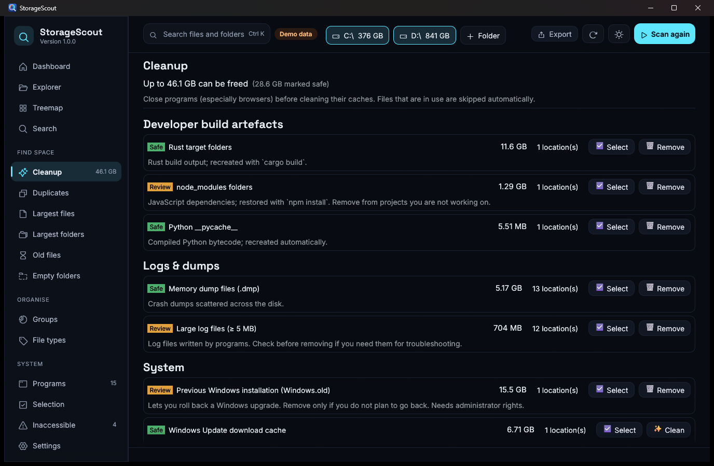
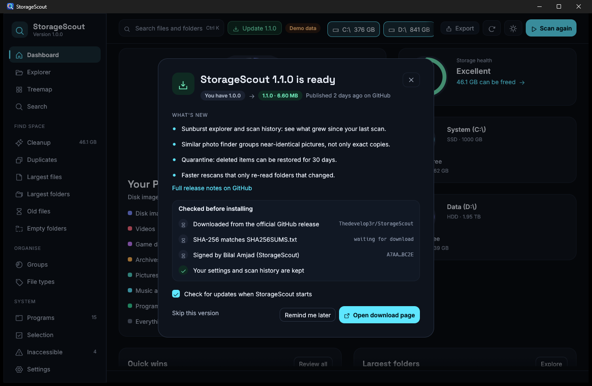

# StorageScout

A fast desktop disk analyser for Windows (also builds on Linux and macOS), written purely in
**Rust** with **egui**. It scans every drive, file and program on the computer and shows what is
using space, grouped and sorted, so you can inspect anything, jump to its location and clean up
safely.

## Features

- **Drives**: capacity, free space and file system of every volume.
- **Fast parallel scan** of whole drives or chosen folders, with live progress and cancel.
  Symlinks and junctions are not followed. Cloud-only OneDrive files count as 0 bytes.
- **Overview**: totals, space by category, largest folders and files.
- **Explorer**: drill-down folder browser sorted by size, with share bars and breadcrumbs.
- **Treemap**: squarified, zoomable map of any folder.
- **Groups**: videos, music, pictures, documents, archives, programs, source code, build output,
  game data, disk images and VMs, databases, system files, temp files, other. Each group can be
  narrowed down by extension.
- **File types**: size and count for every extension.
- **Largest files / folders**, **old files** (not modified for N days), **empty folders**, all
  with search, type filter, minimum size and sorting.
- **Duplicates**: compares size, then a quick hash, then a full xxHash3 hash. One click selects
  every copy except the newest or the oldest.
- **Programs**: installed programs from the registry (all users, 32-bit and current user),
  Microsoft Store apps, and *not installed* / portable executables found on disk. Shows the
  measured folder size, opens the install location, and runs the uninstaller.
- **Cleanup**: temp folders, Windows Update cache, crash dumps, error reports, thumbnail cache,
  `Windows.old`, Recycle Bin, browser caches (Chrome, Edge, Brave, Vivaldi, Opera, Firefox),
  package caches (npm, Yarn, pnpm, pip, Cargo, Gradle, NuGet, Maven, Go), `node_modules`, Rust
  `target`, `__pycache__`, large logs, dump files and installers left in Downloads.
- **Search** the whole index by name, with `*` and `?` wildcards.
- **Actions** on every item (right-click): open, show in file manager, browse in StorageScout,
  show in treemap, copy path, select, empty folder, delete.
- **Selection**: tick items in any view and delete them together.
- **Safe deletion**: confirmation dialog, Recycle Bin by default, and protection for drive roots,
  the Windows directory, Program Files, the user profile and system-managed files.
- **Export**: largest files and folders, programs (CSV), scan summary (JSON).
- **Updates**: if you allow it, StorageScout checks GitHub for a new release once a day, shows
  what's new, and installs it on request after checking the SHA-256 and the code signature.
- **Settings**: light or dark theme, four accent colours, update preferences.

## Screenshots

Taken with `--demo`: all drives, folders, files and programs shown are made up; no real computer
was scanned.

| Dashboard | Treemap |
| --- | --- |
|  |  |
| **Cleanup** | **Update available** |
|  |  |

## Download

Get the latest installer or portable zip from the
[Releases page](https://github.com/Thedevelop3r/StorageScout/releases).

- `StorageScout-Setup-<version>-x64.exe` installs StorageScout for you or for all users, with a Start
  menu entry and an uninstaller (Settings → Apps).
- `StorageScout-<version>-x64-portable.zip` runs without installing.
- `SHA256SUMS.txt` lists checksums of the files, and `storagescout-codesign.cer` is the public
  signing certificate.

Requires 64-bit Windows 10 or 11.

## Build and run

Requires a recent stable Rust toolchain (edition 2024).

```bash
cargo run --release
```

Use the release build: scanning is many times faster than in a debug build.

Command-line options:

```bash
storagescout.exe "D:\\" "C:\Users\me\Videos" --view=treemap
```

- Folders or drives given as arguments are scanned right away. A drive root ticks that drive.
- `--view=<name>` opens a view at start: `overview`, `explorer`, `treemap`, `search`, `groups`,
  `filetypes`, `programs`, `largestfiles`, `largestfolders`, `oldfiles`, `duplicates`,
  `emptyfolders`, `cleanup`, `selection` or `inaccessible`.
- `--demo` loads a fictional computer instead of scanning yours.
  Opening, deleting and scanning are disabled in demo mode.

Run as administrator to include folders that need elevated rights (they are otherwise listed
under **Inaccessible**).

## Notes

- Sizes are logical file sizes. Hard links (for example inside `C:\Windows\WinSxS`) are counted
  once per link, so the scanned total can be higher than the drive's used space.
- Space used by restore points, shadow copies and file system metadata is not visible to a file
  scan. The overview shows it as "not visible to scan".

## Code signing

Releases are signed with the project's own self-signed certificate, so Windows SmartScreen will
still warn when you start the installer: choose **More info → Run anyway**. The signature lets you
verify that the file comes from this project; see [SIGNING.md](SIGNING.md) for the certificate
thumbprint and how to check it. You can also build StorageScout yourself from source.

## Privacy

This program will not transfer any information to other networked systems unless specifically
requested by the user or the person installing or operating it. StorageScout has no telemetry or
analytics. Its only network use is the update check, which it asks permission for on first start
and which sends no personal data. See the [privacy policy](PRIVACY.md).

## Windows installer

The installer is built with [Inno Setup 6](https://jrsoftware.org/isinfo.php) from
[`installer/storagescout.iss`](installer/storagescout.iss):

```bash
cargo build --release
```

```bash
iscc /DAppVersion=0.1.0 installer\storagescout.iss
```

The installer is written to `dist\`.

## Releasing

1. Set a new `version` in `Cargo.toml` and merge the change into `main`.
2. The Release workflow tests, builds, signs the app, the installer and the uninstaller with the
   project certificate, and publishes release `v<version>` (it creates the tag). Pushing a tag
   `v<version>` yourself does the same.
3. Installed copies of StorageScout find the new release and offer to update.

A version is published only once: pushes to `main` that keep the same version build without
publishing. Publishing fails if the signing secrets are missing, because StorageScout refuses to
install an unsigned update.

Signing needs the repository secrets `SIGNING_CERT_PFX_BASE64` and `SIGNING_CERT_PASSWORD`,
created once with `scripts/create-signing-cert.sh` (see the comments in that script).

## Tests

```bash
cargo test
```

## Project layout

See [PLAN.md](PLAN.md) for the design and the module overview.

## License

[MIT](LICENSE) © 2026 Bilal Amjad
